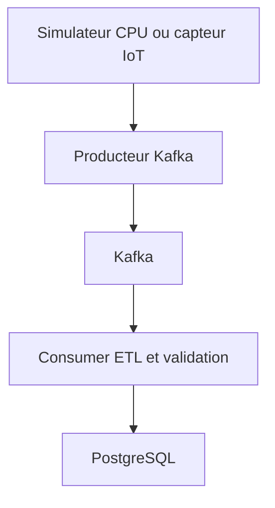
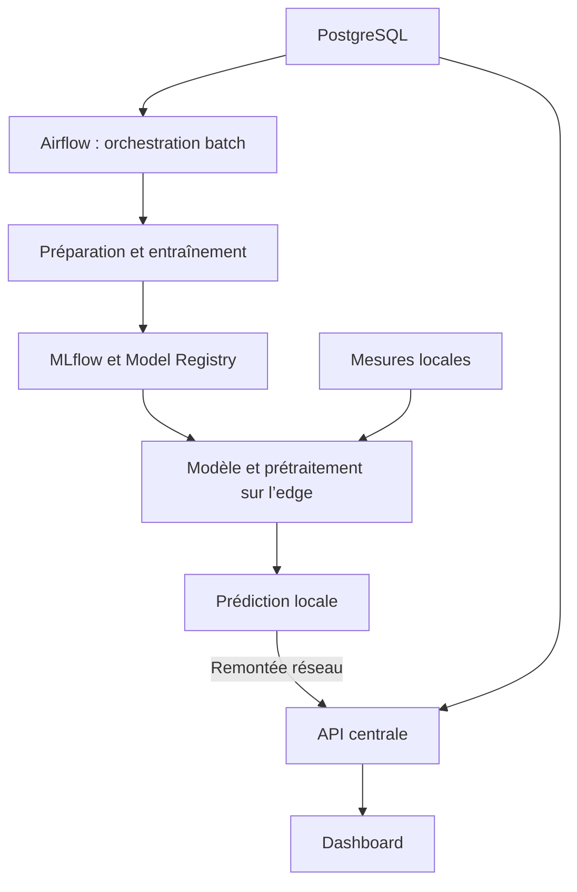

# Architecture du système d’irrigation

[TMGROUP-11](https://dataopsfsa.atlassian.net/browse/TMGROUP-11) · [Décisions d’architecture sur Confluence](https://dataopsfsa.atlassian.net/wiki/spaces/IRRIG/pages/5570561)

## Collecte et stockage



Sur `main`, le simulateur produit du JSONL sur la sortie standard. La V0.1 intégrée vise la publication, la lecture et le stockage de 20 mesures. La preuve attendue comprend les compteurs du producteur et du consumer ainsi qu’une requête SQL filtrée sur le lot de démo, avec 20 lignes distinctes. Les commandes de bout en bout seront ajoutées avec les services d’intégration.

## Orchestration batch, déploiement et inférence



Airflow déclenche les traitements batch. MLflow enregistre les expériences et la version du modèle validé. Avant une coupure réseau, la cible edge reçoit le modèle et le prétraitement compatibles. L’inférence cible utilise ensuite uniquement les artefacts et les mesures disponibles localement. L’envoi de télémétrie et de prédictions, la synchronisation des modèles et la consultation du dashboard passent par la plateforme centrale. Aujourd’hui, le simulateur tourne hors ligne une fois installé et émet des mesures synthétiques. Le modèle edge et les services centraux restent à intégrer.

## Arborescence

| Chemin | Contenu actuel |
|---|---|
| `src/irrigation_edge_ai/__main__.py` | Vérification du démarrage Python |
| `src/irrigation_edge_ai/simulator.py` | Génération et émission des mesures |
| `tests/` | Tests du simulateur et du démarrage |
| `data/raw/`, `data/processed/` | Données locales ignorées par Git |
| `compose.yaml`, `Dockerfile` | Services de développement et de simulation |
| `docs/` | Architecture, guide Docker et conventions de contribution |

## Contrat de télémétrie v1

Chaque mesure est un objet JSON UTF-8. Le simulateur écrit un objet par ligne. Le producteur Kafka doit publier un objet par message et utiliser `device_id` comme clé pour regrouper les mesures du même appareil.

```json
{
  "schema_version": 1,
  "device_id": "edge-sim-01",
  "simulated": true,
  "sequence": 1,
  "timestamp_utc": "2026-11-13T09:00:00.000000+00:00",
  "soil_moisture_pct": 46.97,
  "air_temperature_c": 18.5,
  "relative_humidity_pct": 41.5
}
```

| Champ obligatoire | Type et validation |
|---|---|
| `schema_version` | Entier égal à 1 |
| `device_id` | Chaîne non vide |
| `simulated` | Booléen indiquant une mesure synthétique |
| `sequence` | Entier supérieur ou égal à 1, réinitialisé à chaque lancement |
| `timestamp_utc` | Date et heure ISO 8601 avec fuseau UTC explicite |
| `soil_moisture_pct` | Nombre fini de 0 à 100, en % |
| `air_temperature_c` | Nombre fini, en °C |
| `relative_humidity_pct` | Nombre fini de 0 à 100, en % |

Les plages du générateur sont propres à la simulation. Le consumer cible contrôle les types, la version et les unités avant insertion. Une mesure invalide doit être comptabilisée avec un motif et écartée des mesures valides. Pour le simulateur v1, la clé d’idempotence proposée est `(device_id, timestamp_utc, sequence)`. Le consumer conserve l’horodatage de la source et valide l’offset après persistance ou traitement explicite du rejet. Le contrat de prédiction sera défini après validation de la cible et de l’horizon de prévision.

## Démarrage

Voir le [README](../README.md) pour les commandes disponibles sur un PC de 8 Go.
